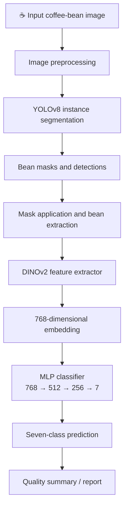
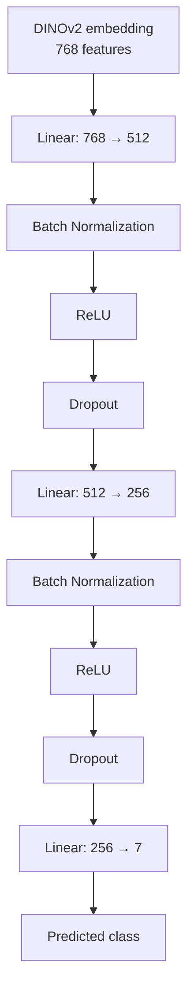
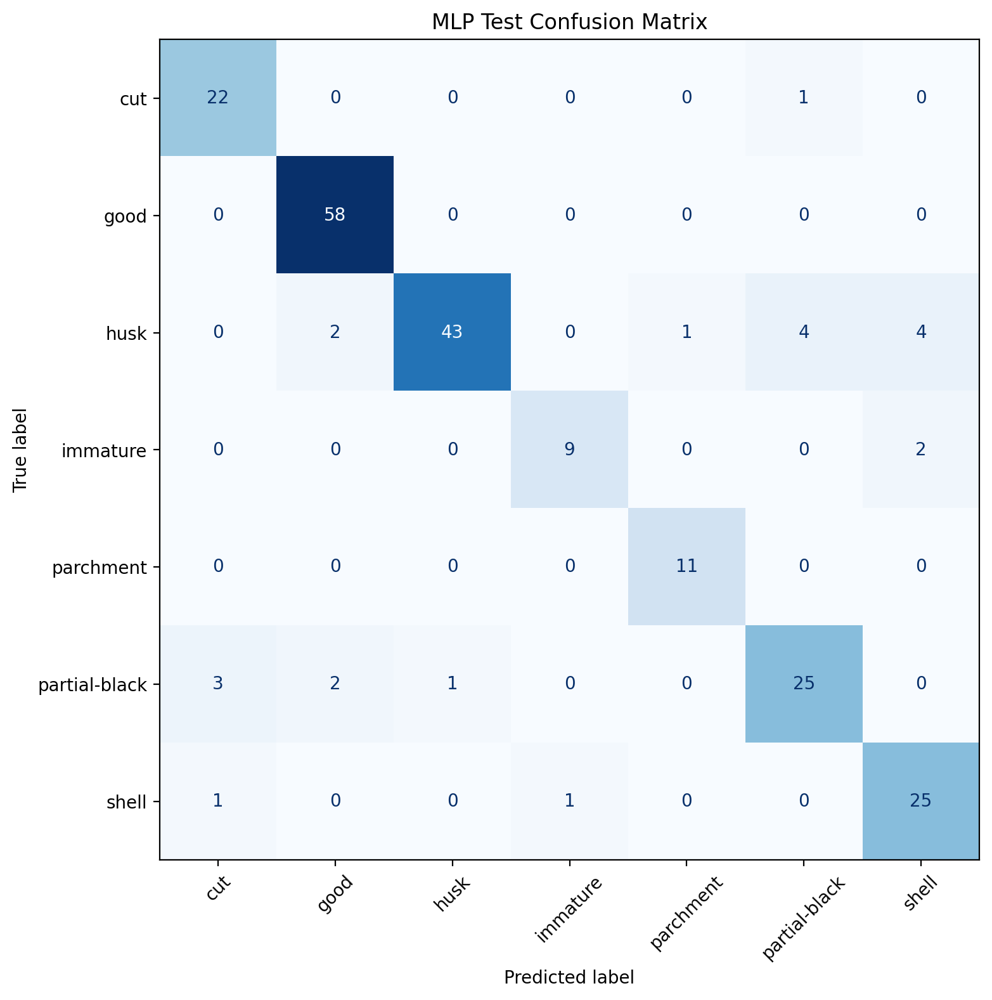
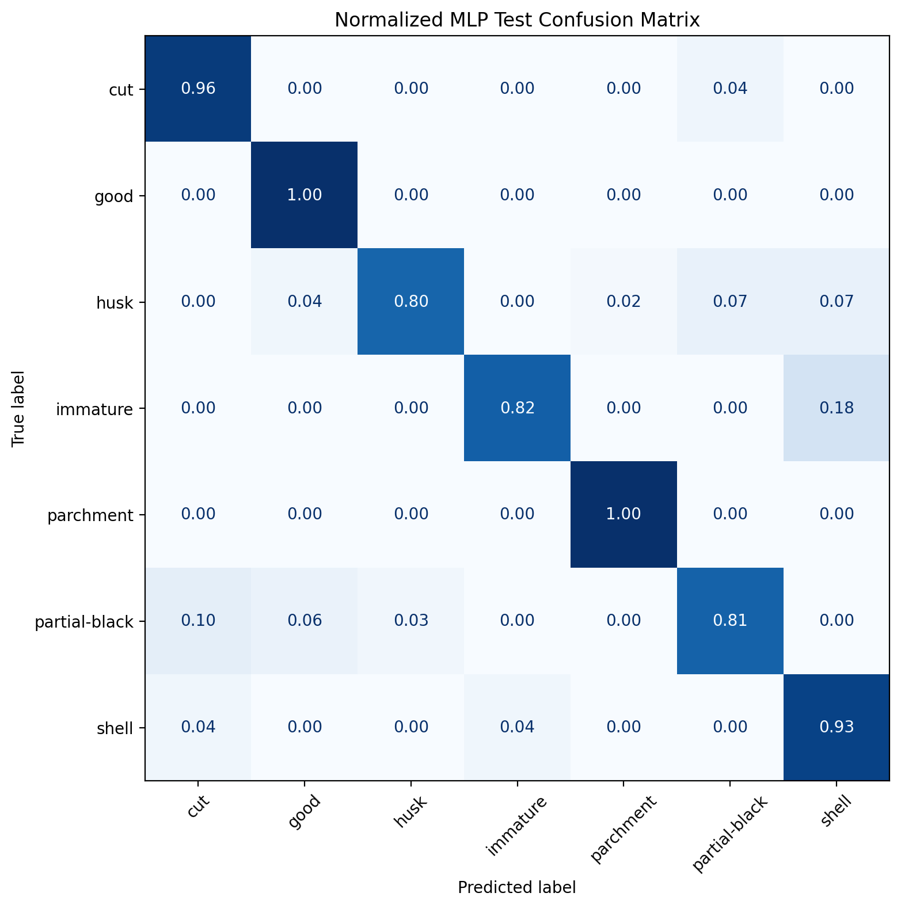
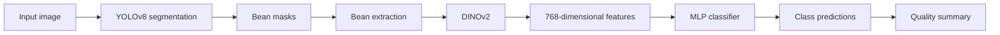

<div align="center">

# ☕ BeanVisionAI

### AI-Powered Coffee Bean Quality Assessment

**Segment · Extract · Classify · Assess**

A modular computer-vision pipeline combining **YOLOv8 instance segmentation**, **DINOv2 visual embeddings**, and a custom **MLP classifier** to assess individual coffee beans.

<p>
  
  
  
  
  
  
  <a href="LICENSE"></a>
</p>

<p>
  <a href="#-overview">Overview</a> ·
  <a href="#-pipeline-architecture">Architecture</a> ·
  <a href="#-results">Results</a> ·
  <a href="#-setup">Setup</a> ·
  <a href="#-roadmap">Roadmap</a>
</p>

</div>

---

## 📖 Overview

Coffee bean inspection is often performed through manual visual examination. That process can be time-consuming and subjective, and it may be difficult to scale consistently.

**BeanVisionAI** explores a multi-stage deep-learning workflow for identifying individual beans and classifying them into seven predefined categories.

Instead of using a single model for the entire task, the project separates the workflow into distinct stages:

1. **YOLOv8 segmentation** identifies individual bean instances and produces masks.
2. **Bean extraction** uses the masks to isolate beans from their backgrounds.
3. **DINOv2** converts each bean image into a **768-dimensional visual embedding**.
4. A custom **Multi-Layer Perceptron (MLP)** predicts one of seven classes from the embedding.
5. Evaluation utilities generate classification metrics, prediction tables, and confusion-matrix visualizations.

> **Project status:** The segmentation and feature-based classification workflow has been developed, and an MLP test-set evaluation has been run. ONNX export has been explored. Real-time edge-device deployment and automated physical sorting remain future work.

## ✨ Highlights

- 🫘 Individual coffee-bean instance segmentation and extraction
- 🧬 DINOv2 feature extraction using 768-dimensional embeddings
- 🧠 Custom MLP classifier with batch normalization, ReLU, and dropout
- 🏷️ Seven-class prediction
- 📊 Classification reports, confusion matrices, and per-sample predictions
- 🧩 Modular pipeline with separate segmentation and classification stages
- 📦 ONNX export exploration for portability
- 🔬 Model evaluation and error-analysis capabilities
- 📈 A foundation for future edge-device deployment

## 🧭 Pipeline Architecture



### Model components

| Stage | Component | Purpose |
|---|---|---|
| 1 | YOLOv8 segmentation | Locate individual beans and predict instance masks |
| 2 | Mask-based extraction | Isolate each bean for downstream analysis |
| 3 | DINOv2 (`facebook/dinov2-base`) | Extract visual representations from bean images |
| 4 | MLP classifier | Map 768-dimensional features to seven class scores |
| 5 | Evaluation utilities | Summarize classification performance and errors |

### MLP architecture



The classifier uses a `768 → 512 → 256 → 7` layout, with batch normalization, ReLU activations, and dropout between the linear layers.

The evaluation script loads the saved classifier checkpoint rather than retraining the model.

## 🏷️ Supported Classes

The classification pipeline uses the following seven labels:

| ID | Class | Meaning in this project |
|---:|---|---|
| `0` | `cut` | Bean classified as cut |
| `1` | `good` | Bean classified as good |
| `2` | `husk` | Husk |
| `3` | `immature` | Immature bean |
| `4` | `parchment` | Parchment |
| `5` | `partial-black` | Partially black bean |
| `6` | `shell` | Shell |

The class mapping used by the evaluation script is:

```python
CLASS_NAMES = {
    0: "cut",
    1: "good",
    2: "husk",
    3: "immature",
    4: "parchment",
    5: "partial-black",
    6: "shell",
}
```

Class labels are reproduced as used in the project. Their formal definitions should follow the dataset annotation guide when preparing a research report.

---

## 📊 Results

### 1. DINOv2 + MLP Classification

The MLP was evaluated on the saved test feature matrix in `data/processed/test_data.npz`.

The test data contains **215 samples**, each represented by **768 features**, with corresponding ground-truth labels. The evaluation script loaded `models/MLP/mlp_classifier.pth`.

#### Overall test results

| Metric | Result |
|---|---:|
| **Test accuracy** | **89.77%** |
| Macro precision | 89% |
| Macro recall | 90% |
| Macro F1-score | 89% |
| Weighted F1-score | 90% |
| Number of test samples | 215 |

#### Per-class classification report

| Class | Precision | Recall | F1-score | Support |
|---|---:|---:|---:|---:|
| `cut` | 0.85 | 0.96 | 0.90 | 23 |
| `good` | 0.94 | 1.00 | 0.97 | 58 |
| `husk` | 0.98 | 0.80 | 0.88 | 54 |
| `immature` | 0.90 | 0.82 | 0.86 | 11 |
| `parchment` | 0.92 | 1.00 | 0.96 | 11 |
| `partial-black` | 0.83 | 0.81 | 0.82 | 31 |
| `shell` | 0.81 | 0.93 | 0.86 | 27 |
| **Macro average** | **0.89** | **0.90** | **0.89** | **215** |
| **Weighted average** | **0.90** | **0.90** | **0.90** | **215** |

*Per-class metrics are rounded to two decimal places.*

### 2. Confusion Matrix Analysis

The confusion matrix helps identify which coffee bean classes are classified correctly and which categories are commonly confused.

#### Raw confusion matrix



#### Normalized confusion matrix



The raw matrix shows the number of predictions for each actual-versus-predicted class combination. The normalized matrix expresses those results proportionally, making it easier to compare class-level performance when class counts differ.

#### Observations

- **Good beans:** The classifier achieved a recall of 1.00 on the test samples for this class.
- **Parchment:** The observed recall was 1.00, but this class has only 11 test samples, so the result should be interpreted cautiously.
- **Husk:** Recall was 0.80, making missed husk predictions an area for further investigation.
- **Partial-black:** The F1-score was 0.82, suggesting room for improvement.
- **Shell:** Precision was 0.81, so some predictions labelled as shell may belong to other classes.

These observations should be investigated further by examining individual prediction errors and the confusion matrix.

> **Important evaluation note:** The **89.77% accuracy is the MLP classifier's test accuracy using precomputed DINOv2 features**. It is not an end-to-end accuracy measurement for the complete YOLOv8 → bean extraction → DINOv2 → MLP pipeline. It also does not measure segmentation quality.

### 3. YOLOv8 Segmentation Metrics

The following metrics were previously reported for a YOLOv8 segmentation experiment.

| Metric | Previously reported result |
|---|---:|
| Precision | 97.59% |
| Recall | 89.27% |
| mAP@50 | 94.87% |
| mAP@50–95 | 92.62% |

These values belong to the segmentation experiment and are separate from the MLP classification results.

They should not be treated as a final reproducible benchmark until the checkpoint, dataset configuration, evaluation split, and evaluation procedure have been recorded and the evaluation rerun.

### 4. Generated Evaluation Artifacts

The evaluation script produces the following files:

| Artifact | Path |
|---|---|
| Raw confusion matrix image | `outputs/confusion_matrix/confusion_matrix.png` |
| Normalized confusion matrix image | `outputs/confusion_matrix/confusion_matrix_normalized.png` |
| Confusion matrix data | `outputs/confusion_matrix/confusion_matrix.csv` |
| Classification report | `outputs/metrics/classification_report.csv` |
| Evaluation summary | `outputs/metrics/evaluation_summary.json` |
| Per-sample predictions | `outputs/predictions.csv` |
| Evaluation log | `outputs/logs/mlp_evaluation.txt` |

These files allow the evaluation results to be reviewed without relying exclusively on the headline accuracy.

---

## 🗂️ Repository Structure

The following tree summarizes the main project areas and known model and evaluation artifacts. Optional files may differ as the repository evolves.

```text
BeanVision_AI/
├── assets/
├── configs/
├── data/
│   ├── raw/
│   └── processed/
│       ├── train_data.npz
│       ├── valid_data.npz
│       └── test_data.npz
├── docs/
├── models/
│   ├── MLP/
│   │   └── mlp_classifier.pth
│   ├── ONNX/
│   └── yolov8/
│       ├── best.pt
│       └── v8_75.pt
├── notebooks/
├── outputs/
│   ├── confusion_matrix/
│   │   ├── confusion_matrix.csv
│   │   ├── confusion_matrix.png
│   │   └── confusion_matrix_normalized.png
│   ├── logs/
│   │   └── mlp_evaluation.txt
│   ├── metrics/
│   │   ├── classification_report.csv
│   │   └── evaluation_summary.json
│   └── predictions.csv
├── src/
│   └── evaluate_mlp.py
├── tests/
├── .gitignore
├── LICENSE
├── README.md
└── requirements.txt
```

The tree is a documentation guide, not a guarantee that every optional file is present in every checkout. Keep it synchronized with the repository as the project changes.

## 📁 Dataset

The project uses training, validation, and test splits for the segmentation and classification workflow.

The raw segmentation dataset is expected to contain images and YOLO-format label files, with a dataset YAML file defining paths and class names. Confirm the actual dataset location and permissions before sharing or redistributing data.

A typical YOLO-format dataset layout is:

```text
CoffeeBeanMasking/
├── train/
│   ├── images/
│   └── labels/
├── valid/
│   ├── images/
│   └── labels/
├── test/
│   ├── images/
│   └── labels/
└── data.yaml
```

### Processed classification features

The test data used by the evaluation script contains:

```text
test_data.npz
├── features: (215, 768), float32
└── labels:   (215,),     int64
```

Each row of the feature matrix corresponds to a bean sample represented by a 768-dimensional DINOv2 embedding.

Before publishing raw images or annotations, confirm that the dataset owner, research collaborators, and institution permit redistribution and add any required attribution.

---

## ⚙️ Setup

### 1. Clone the repository

```bash
git clone https://github.com/Nikhil-cloudexpert/BeanVision_AI.git
cd BeanVision_AI
```

### 2. Create and activate a virtual environment

**Windows PowerShell**

```powershell
python -m venv venv
.\venv\Scripts\Activate.ps1
```

**Linux / macOS**

```bash
python3 -m venv venv
source venv/bin/activate
```

If PowerShell blocks activation because of the current execution policy, use the Python executable inside the virtual environment directly or follow your organization's approved policy for script execution.

### 3. Install dependencies

```bash
python -m pip install --upgrade pip
pip install -r requirements.txt
```

Use a PyTorch build compatible with your Python version and hardware. GPU acceleration is helpful for training and feature extraction, but the saved-feature MLP evaluation can run on a CPU.

### 4. Run the MLP evaluation

From the repository root, run:

```bash
python src/evaluate_mlp.py
```

The script expects the following files to exist:

```text
data/processed/test_data.npz
models/MLP/mlp_classifier.pth
```

It evaluates the saved MLP checkpoint against the test features and writes the classification report, confusion matrices, predictions, and log to `outputs/`.

> This command evaluates the classifier using precomputed features. It does not rerun YOLOv8 segmentation or DINOv2 feature extraction.

---

## 🏋️ Training Workflow

The following commands are examples. Confirm the dataset YAML path, class names, package versions, and output paths before running a training job.

### Stage 1 — Train YOLOv8 segmentation

Example command:

```bash
yolo task=segment mode=train model=yolov8n-seg.pt data=path/to/data.yaml epochs=100 imgsz=640 batch=16
```

Replace `path/to/data.yaml` with the actual dataset configuration path.

### Stage 2 — Extract individual beans

Use the trained segmentation model to predict masks and isolate bean instances. The exact command depends on the extraction script and its arguments in the current repository.

### Stage 3 — Extract DINOv2 features

Process the isolated bean images with `facebook/dinov2-base` and save one 768-dimensional embedding per bean.

Ensure that the resulting feature arrays remain aligned with their labels and their training, validation, and test splits.

### Stage 4 — Train the MLP

Train the classifier on the training embeddings, select settings using validation data, and reserve the test set for final evaluation.

Save the resulting checkpoint and record the experiment configuration for reproducibility.

---

## 🔎 Inference

The intended full inference path is:



The exact image- and folder-inference commands depend on the inference entry point available in the current checkout.

The `evaluate_mlp.py` script evaluates saved features and labels; it should not be treated as an end-to-end image-inference script.

---

## 📦 Model Export and Deployment

ONNX export has been explored for portability. Exporting a model does **not**, by itself, confirm that the entire multi-model pipeline runs correctly on a target device.

Potential deployment targets include:

- Desktop or server inference
- A containerized application
- An API and web dashboard
- Raspberry Pi or other edge hardware, after compatibility and performance testing
- Industrial camera and sorting integrations as longer-term work

The complete pipeline may require separate compatibility, latency, memory, and accuracy testing for each target.

Edge deployment, live camera processing, and automated physical sorting remain future work until they have been implemented and validated.

---

## 🛣️ Roadmap

- [x] Seven-class label mapping
- [x] YOLOv8 segmentation workflow
- [x] Individual bean mask/extraction workflow
- [x] DINOv2 feature extraction
- [x] 768-dimensional feature dataset
- [x] MLP seven-class classifier
- [x] MLP test-set evaluation and report generation
- [x] Confusion matrix generation
- [x] ONNX export exploration
- [ ] Rerun and document reproducible YOLOv8 segmentation evaluation
- [ ] Analyze the most frequent class confusions
- [ ] Expand and balance the dataset where appropriate
- [ ] Tune classifier hyperparameters and evaluate robustness
- [ ] Add reproducible end-to-end image inference instructions
- [ ] Benchmark latency and memory use
- [ ] Complete API/dashboard packaging and testing
- [ ] Validate Raspberry Pi or another edge-device deployment
- [ ] Explore camera-based real-time inspection and automated sorting

## 🔬 Future Scope

Potential extensions include:

- **More robust evaluation:** repeatable test protocols, cross-validation, and error analysis.
- **Feature comparison:** compare DINOv2 embeddings with alternative feature extractors.
- **Classifier comparison:** evaluate MLP, SVM, and Random Forest models on the same feature splits.
- **Dataset improvement:** review class imbalance, annotation consistency, and difficult examples.
- **Deployment optimization:** profile model latency, memory, and throughput on target hardware.
- **Quality analytics:** track class distributions and batch-level quality summaries.
- **Industrial integration:** investigate camera input and sorting hardware after model reliability is validated.

## 🔁 Reproducibility

For every experiment, record:

- Dataset version and split
- Class mapping
- Model checkpoint and architecture
- Image size and preprocessing
- Training epochs, batch size, learning rate, and optimizer
- Random seed
- Python, PyTorch, and Ultralytics versions
- Hardware and inference device
- Evaluation metrics and output artifacts

Keep test data separate from model selection and hyperparameter tuning to reduce the risk of overly optimistic performance estimates.

## 🤝 Contributing

Contributions, bug reports, and suggestions are welcome.

1. Fork the repository.
2. Create a feature branch: `git checkout -b feature/your-feature`
3. Make and test your changes.
4. Commit your changes: `git commit -m "Describe your change"`
5. Push the branch and open a pull request.

For substantial changes, include the motivation, implementation details, testing performed, and relevant screenshots or benchmark results.

Do not commit private data, credentials, large generated files, or model artifacts unless they are intended to be versioned.

## 🐛 Issues

When reporting a problem, include relevant details where possible:

- Operating system and Python version
- PyTorch and Ultralytics versions
- CPU/GPU information
- Dataset split and configuration
- Checkpoint used
- Exact command and error message
- Steps to reproduce
- Relevant screenshots or logs

## 📜 License

This project declares the **MIT License**. See [`LICENSE`](LICENSE) for the complete license text.

Ensure that the license file is present and matches the license you intend to use.

## 🙏 Acknowledgements

BeanVisionAI builds on the open-source computer-vision and machine-learning ecosystem, including:

- **YOLOv8 / Ultralytics** — object detection and instance segmentation
- **DINOv2** — visual feature representations
- **PyTorch** — deep learning
- **OpenCV** — image processing
- **NumPy** — numerical computing
- **scikit-learn** — evaluation metrics
- **Roboflow** — dataset annotation and preparation
- **ONNX** — model interoperability

Please consult and follow each project's license and citation guidance when using its software or pretrained models.

## 📚 Citation

If you reference this project in academic work, presentations, or derivative projects, cite the repository and include the relevant version or commit where possible.

```bibtex
@software{beanvisionai,
  title  = {BeanVisionAI: AI-Powered Coffee Bean Quality Assessment},
  author = {Nikhil},
  year   = {2026},
  url    = {https://github.com/Nikhil-cloudexpert/BeanVision_AI}
}
```

## 👨‍💻 Author

<div align="center">

**Nikhil**  
B.Tech Computer Science and Engineering — Artificial Intelligence & Machine Learning  
GLA University, Mathura, India

</div>

## ⭐ Support

If you find the project useful, consider starring or forking the repository, reporting issues, suggesting improvements, or contributing a tested enhancement.

---

<div align="center">

### ☕ BeanVisionAI

**YOLOv8 × DINOv2 × MLP**

*Making coffee-bean quality assessment smarter with AI.*

</div>